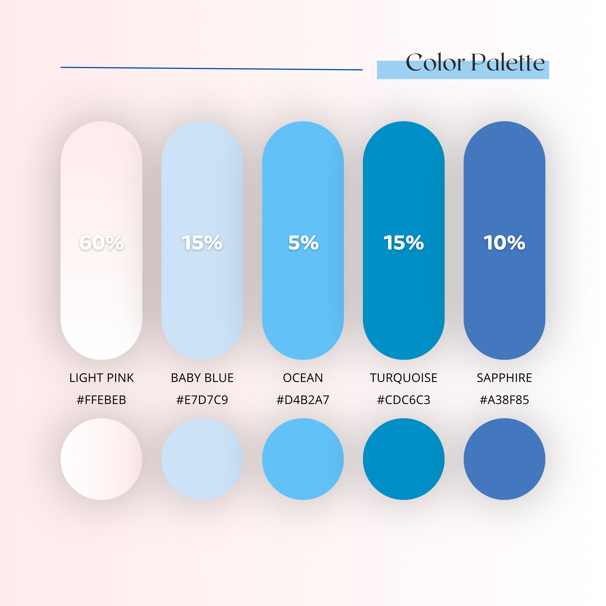
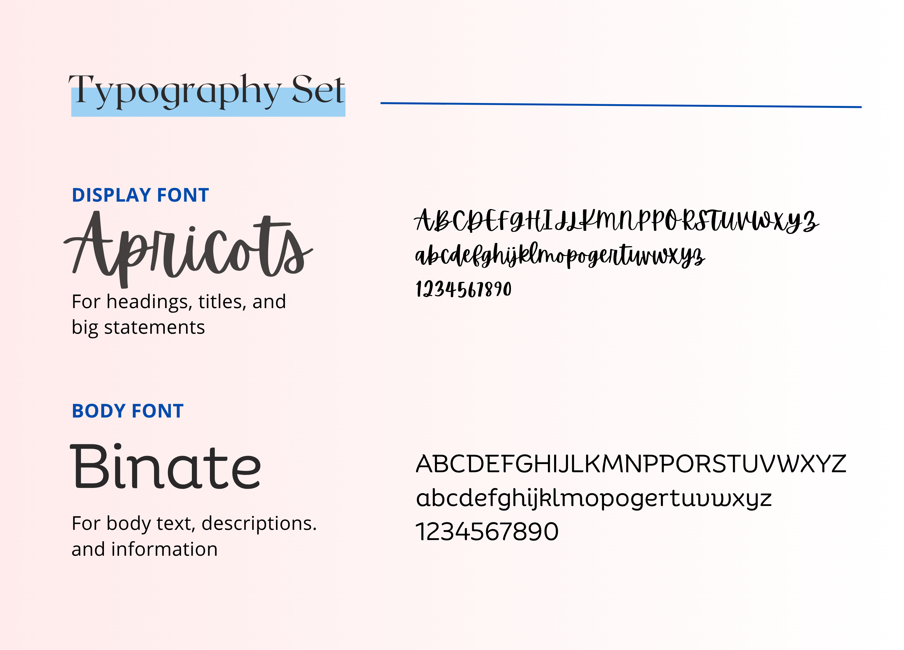

# COLOR PALETTE & TYPOGRAPHY

Examines color contrast ratios, accessible color choices, and strategic font pairings. Concentrates on creating visually pleasing interfaces that ensure cross-platform accessibility.

  
  
  
  
  

